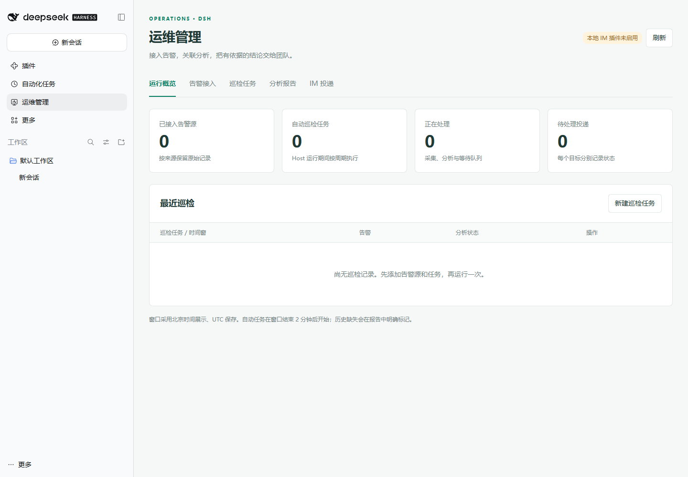

# DSH Ops Assistant

DSH 运维管理插件：持续采集告警 → 本地保存 → 按巡检周期查询分析 → 本地报告 → 可选 IM 投递。



目标：DeepSeek Harness **0.2.2-rc.1 或更高的 0.2.x 版本** Web profile，Ubuntu 24.04，Node.js 22.19 或更高。新版查询方案使用 DSH 的工具执行接口，升级插件前应确认 DSH 版本。插件在 DSH 左侧增加“运维管理”，包括告警接入、巡检任务、分析报告和可选 IM 投递。

0.3.0 增加独立的 **MCP 数据字典**：持久保存工具用途、字段含义、关联方式、时间口径和查询模板，支持发现工具、导入文档及只读样例验证。查询方案按用途引用字典，巡检任务仍只选择方案；分析时加载本轮引用的说明与查询结果。保留共享方案、历史快照、查询耗时、飞书五段卡片、本地格式修正、单轮会话复用、零告警静默和持续采集。现有任务不强制切换字典；生产模型及飞书投递仍需在实际环境验收，验证范围见 [验证记录](docs/VALIDATION.md)。

## 已实现

- 告警源启用后独立后台采集，未创建巡检任务也会保存告警。支持 Zabbix JSON-RPC、夜莺历史告警（排除恢复记录）和 Alertmanager 快照；采集间隔默认 60 秒，可在来源设置中修改。
- 多个巡检任务；手动执行或按周期执行，默认 30 分钟。每次实际开始执行时，从本地查询此前一个巡检周期的告警，再交给 DSH 分析。
- DSH 每轮巡检创建一个独立分析会话，分批分析与合并共用该会话；复用当前 Host 的模型、Agent Preset 和 MCP，查询方案统一维护 Markdown 排查步骤，任务选择引用。
- 分批提供告警原文，合并跨批关联结果。用实际告警 ID 集合验证模型报告覆盖度；无法覆盖时标失败，不发布成完整分析。
- “查询方案”独立管理可复用的命名方案，任务只保存方案引用；编辑后影响后续新批次，入队及历史报告保留方案快照。内置网络 ping 和通用取证模板；从现有 MCP 自动识别 PostgreSQL、Neo4j、知识库与记忆检索用途，多候选时由用户指定。固定查询只取相关对象和窗口；AI 通过受控补查入口获取证据，无需逐个勾选工具。
- 报告记录查询方案、各次查询的用途、耗时、状态、结果量和缓存命中，可导出证据。资产映射采用短期缓存，窗口故障状态与结论不跨轮复用。
- “MCP 数据字典”集中管理查询知识和声明式模板；文档导入先生成可编辑草稿，验证通过后可供方案引用。条目修订随批次冻结，编辑后需重新验证；被引用条目禁止直接删除。字典随本地数据库持久保存和迁移，无需另装记忆服务，详见 [数据字典使用说明](docs/MCP-DICTIONARY.md)。
- SQLite 保存持续采集的告警原文、采集进度、批次、报告、运行状态和投递记录；数据目录可自定义，迁移时一起搬走。Token 通过 DSH 凭据服务保存，不进入数据库和浏览器读接口。
- IM 三种模式：关闭、人工查看后推送、完成后自动推送。选择本机 DSH-IM 机器人以及它已保存的目标，可配置多个目标。
- 窗口内采集到 0 条告警时只保存本地报告，不推送 IM；有告警但分析失败时，可发送明确标记“AI 分析未完成”的数据汇总。IM 投递与分析状态分开。
- 同一窗口不重复创建；同一报告版本及目标不重复发送。明确离线会有限重试；发送结果未知时停止自动重试，必须人工核对。
- 巡检记录支持单条删除和勾选批量删除，清理对应报告与本地投递记录；定时任务配置和持续采集的告警库保留。

## 安装

从 [Releases](https://github.com/shixungan/dsh-ops-assistant/releases) 下载预构建安装包。尚未发布到 npm registry，不能直接按 npm 包名安装。

持续采集与本地窗口查询从 v0.1.2 开始提供，改动记录见 [CHANGELOG](CHANGELOG.md)。

可在 DSH 插件安装框直接填写发布包地址，或使用下面的在线安装命令。**使用运行 DSH 的同一 Linux 用户、相同 DSH_HOME 和 profile** 执行：

```bash
dsh --version
node --version
dsh plugin --profile web add -w https://github.com/shixungan/dsh-ops-assistant/releases/download/v0.3.0/dsh-ops-assistant-0.3.0.tgz --registry=https://registry.npmmirror.com
```

这个安装包已包含构建好的页面，没有运行时 npm 第三方依赖，不需要拉源码构建。无法在线下载时，可将 `.tgz` 上传到服务器，再把上面的 URL 换成该文件的绝对路径。随后按你当前的方式重启 DSH 服务并刷新浏览器；开发测试环境也可启动 `dsh web --no-open`。如果实际 profile 不是 `web`，将命令中的 profile 替换为你实际使用的 profile。

不必重复启动第二个 DSH 实例。已有 systemd 服务时，重启已有服务；本项目没有假定你的服务单元名称。

### 国内源安装（待首次发布）

npm 发布与国内镜像同步流程已准备，**当前尚未完成首次 npm 发布及镜像下载校验**。完成后，可按包名安装或升级，不再请求 GitHub Release 下载地址：

```bash
dsh plugin --profile web add -w dsh-ops-assistant@0.1.9 --registry=https://registry.npmmirror.com
```

`npmmirror` 是 npm 官方仓库的只读镜像，不能直接接收 GitHub 安装包；给 GitHub 直链添加 `--registry` 也不会代理该文件。维护者的首次发布、Trusted Publisher 配置和同步验证见 [npm 与国内镜像发布](docs/NPM-PUBLISH.md)。

### 从早期原型迁移

若已安装此前的 `dsh-ops-manager`，先停用旧插件，避免两个实例同时运行。新包名和默认数据目录均为 `dsh-ops-assistant`；若要沿用原型的数据库，在新插件中将 `dataDir` 指向原目录 `$DSH_HOME/integrations/dsh-ops-manager`。先备份数据库，不要让两个插件同时打开它。

## 第一次配置

1. 打开左侧 **运维管理 → 告警接入**。
2. 添加一个源，填写平台 API 地址、只读 Token 和后台采集间隔（默认 60 秒），勾选启用并保存后即开始后台采集。Zabbix 地址含完整 `api_jsonrpc.php`；夜莺和 Alertmanager 填平台根地址，可带部署子路径。夜莺 v9.1 填写个人信息 → Token 管理创建的 Token，认证配置见下文。可点击“测试采集”核对连通性，并查看来源卡片的本地记录数量及采集进度。
3. 在服务器创建分析工作目录，例如 `mkdir -p /opt/dsh-ops-assistant`，确保 DSH 运行用户可访问。
4. 打开 **运维管理 → 查询方案**，编辑预置方案或新建命名方案。选择网络 ping 或通用取证模板，集中设置 MCP 用途绑定、规则、超时、缓存和补查上限。已有方案可以复制后调整。
5. 如需让 AI 了解数据含义，先在 **MCP 数据字典** 编辑预置条目，或发现 MCP / 导入说明文档，填写工具、字段口径和模板后保存，使用小范围样例验证，再到查询方案中按用途引用。未选择字典的用途继续沿用原模板与工具识别；只有同优先级唯一兼容工具时才自动使用，多候选或缺失记录为证据缺口。WeKnora/MemOS 沿用 DSH 原连接，不自动新增连接。步骤与模板示例见 [数据字典](docs/MCP-DICTIONARY.md)。
6. 创建或配置巡检任务，选择来源和已保存的查询方案，填写工作目录和可选 Agent Preset ID；留空沿用 DSH 默认。“报告补充要求”仍用于业务背景和输出表达；取证规则只在独立查询方案中维护。确认 DSH 本身可正常对话，具体说明见 [查询方案](docs/QUERY-PLANS.md)。
7. 第一次选择 **关闭：只保存在运维平台**，保持“自动巡检”关闭，点击“立即巡检”。
8. 检查报告、数据源覆盖范围、原始告警和分析会话。验证通过后再开启自动巡检。巡检关闭时，已启用的告警源仍持续采集；停用来源才会停止该来源的后台采集。
9. 需要推送时，在 DSH-IM 中接好机器人，在“机器人齿轮 → 新建目标”创建、测试并保存群聊或私聊目标。打开“运维管理 → IM 投递”，选择巡检任务，再选择渠道、机器人、接收目标和投递模式，点击“保存投递配置”。任务配置弹窗也提供相同入口。
10. 如需自定义告警保存位置，在“数据存储”页填写服务器上的绝对目录，例如 `/data/dsh-ops-assistant`，点击“保存目录并迁移数据”。告警原文、采集进度、报告和配置一起迁移，后续采集写入新目录；也可在添加首个来源前先设置目录。

夜莺 v9.1 需在 `etc/config.toml` 开启个人 Token 认证，重启夜莺使配置生效：

```toml
[HTTP.TokenAuth]
Enable = true
```

使用具有目标告警查看权限的专用账号创建 Token；插件通过 `X-User-Token` 请求头发送个人 Token。后台以 API 轮询持续采集，排除恢复记录，无需配置监控数据上报接口或 Webhook。首次采集读取最近 30 分钟，之后依据已保存的采集进度继续增量拉取，并重叠回读最近 2 分钟以接收延迟入库的记录；同一来源的同一事件 ID 重复读取不会新增一条告警。

后台采集间隔与巡检周期互相独立。例如来源每 60 秒采集一次、巡检周期设为 30 分钟：巡检实际在 10:30 开始，就固定查询本地 10:00–10:30 的告警；若排队至 10:35 才开始，则固定为 10:05–10:35。巡检不直接访问夜莺 API。若只有正常轮询造成窗口末尾几十秒尚未入库，会显示“等待后台采集覆盖窗口”，等后台下一轮保存后再分析，查询窗口保持不变；已覆盖时立即分析，无固定延迟。等待最长 2 分钟，且不超过任务总超时预算的三分之一；达到上限后按现有本地数据分析，明确显示仍未覆盖的区间。

**只需接入自己需要的平台**：任务仅检查勾选的来源，只接夜莺即可正常巡检，无需同时接 Zabbix 或 Prometheus。首次采集未完成、窗口前段从未采集、后台失败、长期落后或 Alertmanager 快照历史有限时，不会通过等待把它们当成完整数据。页面和本地报告会显示具体来源和原因，例如“夜莺：窗口末尾待采集 28 秒”；飞书只提示本次数据不完整、结论限于已收到的告警，不展示来源明细。旧报告保留生成时的覆盖结果，升级不会自动改写。

IM 配置按任务保存，可选择多个目标。保存配置不会发送测试消息，也不会修改已有报告的接收目标。列表为空时页面会区分插件未启用、主动投递接口不兼容、机器人未接入和目标未保存；在 DSH-IM 完成配置后点击“刷新渠道与目标”。

**零告警静默**：本批次采集到 0 条告警时，只保存本地报告，不创建新投递，也不能手动推送；即使来源 `partial` 或失败，也不发送空汇总。覆盖缺口和错误仍在本地可查，静默不等于确认无异常。升级前尚待投递的空批次会标为“已跳过”，已送达或发送结果未知的历史记录不被改写或自动重发。有告警时继续按所选投递模式发送。

### 删除巡检记录

在“运行概览 → 最近巡检”或“分析报告”中，可删除已结束的单条巡检记录。“分析报告”支持勾选多条或全选当前显示的可删除记录，再点击“批量删除”。当前列表最多显示最近 100 条，删除刷新后可继续清理更早记录；全选不会选中列表以外的历史数据。

确认后，批次、报告、该批次的告警原文快照、各版本 AI 回复及全部关联的本地 IM 投递记录会一起删除，待发送记录不再投递。此操作不可撤销，需要保留的报告请先导出。持续采集的原始告警库、来源采集进度、巡检任务配置及定时计划、DSH 分析会话均保留；已经发到飞书等平台的消息不会撤回。

排队、读取告警、分析或正在投递的记录暂不可删除。先取消巡检并等待结束，或等待投递完成，再操作。批量删除会重新校验所有选中记录；只要任一条已不存在或仍在执行，整批保留并提示刷新，不会只删一部分。

**飞书原生 Markdown 卡片**：复用已配置的 DSH-IM v5.10.0 机器人和目标，通过 `format: "markdown"` 发送，无需新增 Webhook。卡片按“结论 → 事件 → 事件分析 → 事件关联分析 → 下一步建议动作”分区，使用蓝色标签、分隔线和留白；结论置顶，任务与数量放入事件段，时间与底部巡检 ID 使用灰色辅助文字。建议以固定的 ①②③ 逐条展示，避免客户端重新编号。其他渠道继续使用通用 Markdown，不带飞书专用标签。

最多展开 3 个事件和 3 条去重建议，消息最长 3500 字符。待核实事项按完整条目展示，超长或超量时标明省略数量；不截断结论、否定或条件句。来源明细和完整分析留在本地报告，建议不代表已执行。卡片发送失败或结果未知时不自动改发文本，避免重复消息。

这里使用的是 [DSH-IM 公开的 Markdown 卡片接口](https://github.com/xmanrui/dsh-im/blob/v5.10.0/PROACTIVE_DELIVERY.md)，由飞书 Card 2.0 富文本组件渲染，[支持的标签和分隔线语法见官方文档](https://open.feishu.cn/document/feishu-cards/feishu-card-cardkit/components/markdown?lang=zh-CN)。当前接口不开放自定义卡头或任意卡片 JSON。旧 DSH-IM 可能忽略格式选项，需加载支持 Markdown 主动投递的版本。

以下为内容层次示意，实际飞书卡片带上述分区样式（使用文档示例地址）：

```text
一、结论
探针 A → 探针 B 出现 100% 丢包，根因与恢复状态尚未确认。

二、事件
链路巡检 · 1 条告警 · 1 个事件
2026-11-12 18:00:00 — 18:30:00（北京时间）
探针 A → 探针 B 丢包（192.0.2.10 → 198.51.100.8）
记录时间 18:26:00 · 1 条告警

三、事件分析
当前仅有单次丢包记录，缺少链路与接口指标，无法定位故障点。

四、事件关联分析
仅一个事件，无跨事件关联依据。

五、下一步建议动作
① 核对两端资产及实际转发路径。

② 检查路径接口指标和丢包曲线，确认是否恢复。

巡检 ID：example-inspection-id
```

[查看 IM 投递配置界面示例](docs/im-settings.png)。

DSH-IM 是可选依赖。不安装时告警采集和本地报告照常可用。插件使用 `listBots()`、`listTargets()` 和 `send(botId,targetId,text)`；你的 IM 版本若没有这些服务方法，需使用支持主动投递接口的版本。已按 DSH-IM v5.10.0 的公开契约编写，但没有连接真实飞书账号做投递验收。

## 数据口径

时间窗为 `[start,end)`，页面以北京时间展示。后台采集保存原文和采集进度，巡检只读取本地对应时间范围的记录。成功读取只代表在该 API 账号授权、平台保留期和采集能力范围内查询完成，不代表平台以外的全部告警。

**Zabbix**：后台用 `event.get` 的 `problem_time_from/problem_time_till` 查询与采集窗口相交的问题事件，按 eventid 游标分页；另取恢复事件原文，重复采集更新同一问题事件。巡检按本地问题事件的首次触发时间查询此前一个周期；恢复原文仅作为后台已采集到的附带信息。适配新版 Bearer 或旧版 JSON-RPC auth 鉴权。保留原始等级，避免跨平台等级含义混淆。

**夜莺**：后台使用 `/api/n9e/alert-his-events/list`，按 v9.1 的 `last_eval_time` 设置增量采集的 `stime/etime`，并设置 `is_recovered=0` 排除恢复记录。每轮追赶最多 30 分钟的进度，另含重叠回读范围；分页读取后，将告警和采集进度保存到同一 SQLite 数据库。失败或分页不完整时不推进成功进度，后续继续重试。每轮最多读取 50,000 条，超出上限或分页不完整时明确标记；实际历史覆盖仍受夜莺保留期与账号权限约束。巡检按本地记录的 `last_eval_time` 查询此前一个巡检周期，不额外查询活跃告警或关联恢复状态。

夜莺统计的是历史告警记录：不同历史 ID 的重复提醒分别保留，原文完整保存。告警后来恢复，不会删除此前的触发记录；该触发记录仍可出现在其发生窗口中。因此这里的“排除恢复记录”不代表“当前未恢复告警”，报告不推断持续或恢复状态。窗口外首次触发、但窗口内再次提醒的记录，按此次 `last_eval_time` 纳入窗口。

**Alertmanager**：按来源采集间隔读取 `/api/v2/alerts` 并保存观察结果，默认每 60 秒一次。始终标为 `partial`，不承诺短暂告警完整性；告警从列表消失不会被当成已恢复。它不能还原停机之前或轮询间隔内的全部历史。若 Prometheus 告警由夜莺评估并留存，应优先接夜莺；若需完整 Prometheus 原生规则历史，应另接可重放的规则事件记录或已有告警历史系统。本版没有把当前快照伪装成完整历史。

**原封不动的范围**：API 返回的单条告警 JSON 对象原样保存于 `raw`，Zabbix 恢复事件存于 `recoveryRaw`；夜莺不采集恢复记录。外层加来源和索引。没有保存 HTTP 响应的字节级排版、请求头或 Token。

**分析覆盖**：后端校验输入 ID 是否全部出现在输出事件里，能够检出漏项/编造 ID；这不证明模型对每条告警的推理都正确。请用已知事件和人工报告评估关联质量。

**关联分析表达**：新报告以独立的 `correlation` 字段保存事件之间的关联判断，与各事件的事实及原因分析分开。旧报告没有该字段时仍可读取和投递，消息明确说明暂无独立关联结论，不从时间接近或已有分组推断共同根因。此字段由原有分析回合生成，不另开会话或追加模型调用。

**分析回复格式**：DSH 完成对话后，插件还需校验最终回复。若 JSON 语法错误，只尝试本地保守修正，不再创建 AI 修正会话。支持完整值后的缺失容器闭合（如 `actions` 少了 `]`）、完整 PromQL 标签选择器中的引号转义；不猜测缺失的字段、正文、字符串边界或分隔符。修正后仍检查原文内容未变、结构有效且覆盖全部告警 ID。无法安全修复时标记分析失败，保留原始回复供查看，不把失败当成完整分析。报告详情可查看、导出原始回复、本地修正结果及每步耗时；旧版 AI 修正回复和重新分析之前的版本继续保留。

**分析耗时与会话数量**：每轮执行最多由插件创建一个分析会话，按顺序在同一会话中处理分批原文和跨批合并；重新分析会创建新的独立会话。零告警时直接生成本地说明，即使来源失败也不调用模型。会话标题和提示词带本插件名称或巡检批次标识，可与报告里的“分析会话 ID”核对；列表中已有的历史会话不会因升级自动删除。

从 0.2.0 起，旧 `allowedTools` 和 `maxToolCalls` 不再决定查询行为。0.2.1 会自动把任务内嵌方案迁移为独立命名方案，任务只保存引用；已有规则和排程保留，无需重建。编辑共享方案影响后续新批次，已排队/执行批次、历史报告及重新分析保留原快照。被任务引用的方案不能删除。非 ping 告警继续覆盖，不强行套入网络路径。

固定模板预取与 AI 额外补查分开：默认资产缓存 300 秒、单次查询超时 15 秒、额外补查最多 2 次（0–6）。额外补查为 0 时仍执行方案的固定预取。查询超时发出取消信号并等待 MCP 退出，实际完成时间取决于工具的取消响应。没有匹配工具、查询失败或结果截断都会保留缺口；不会把失败视为“没有异常”。资产缓存为进程内短期缓存，重启失效，不复用窗口事件或本轮故障结论。查询方案说明只指导分析，不允许模型扩大固定模板的查询范围。详细参数及限制见 [查询方案](docs/QUERY-PLANS.md)。

报告中的取证耗时与 AI 回复阶段耗时分别记录，后者包含模型处理及其额外补查，并非纯推理时间。此功能用于查找慢查询和无效补查，不承诺固定秒数完成；插件不会替换模型或修改 DSH 全局默认设置。

## 运行与存储

默认数据库位于：

```text
$DSH_HOME/integrations/dsh-ops-assistant/ops.sqlite
```

若未设置 `DSH_HOME`，采用当前运行用户的 `~/.dsh`。数据库包含来源和任务设置、持续采集的告警原文、采集进度、分析报告、采集快照及 IM 投递记录。后台采集独立于报告，尚未被巡检使用的告警同样保存在此数据库。**凭据、DSH 会话、工作目录文件和宿主日志由 DSH 管理，不随本插件数据库迁移。**

从 0.1.1 开始，可在插件的“数据存储”页查看实际路径并填写新的目录。全部来源共用此目录，不需要逐个指定数据库文件。变更会等待当前实例空闲；仍有管理操作、采集、分析、排队任务或投递正在执行时明确拒绝，请等其完成后重试。迁移使用 SQLite backup 读取 WAL 中已提交记录，将告警原文、采集进度及其他记录一起迁移，校验目标数据库后切换；无需重启，后台随后继续写入新目录。原数据库保留为迁移前副本，此后不再同步。目标不能已有 `ops.sqlite` 或 WAL/SHM 文件，不覆盖、不合并现有数据库。

路径选择持久化在 `$DSH_HOME/integrations/dsh-ops-assistant/storage.json`，这是留在原位置的小型目录指针。已保存的页面设置优先于插件 `dataDir` 配置，重启继续使用新盘。保存过的数据库文件缺失时停止加载并报错，不静默创建空库；请先检查磁盘挂载。迁移中断时旧数据库仍保留，目标残留文件不会被再次覆盖，可选一个新的专用目录重试。

首次部署也可通过 DSH 插件配置设置初始目录（尚未在页面保存路径时生效）：

```yaml
dataDir: /data/dsh-ops-assistant
```

为该目录设置 DSH 用户读写权限。Docker 部署应先挂载磁盘，再填容器内路径。本插件不会重新分区或格式化磁盘。修改 `DSH_HOME` 本身仍是宿主迁移，不能只搬走这个 SQLite 文件而丢失凭据和目录指针。

每个数据库实例仅应由一个 DSH Host 使用；首版是单机单工作进程设计。任务执行并发为 1，避免无 GPU 环境多个长任务互相争抢内存。界面的超时覆盖本地查询和全部分析；任务超时或输出超限会明确失败，原始记录仍可查看。后台采集与任务执行独立运行。

DSH 进程停止期间不会采集或发消息。重启后，支持历史查询的来源从已保存的采集进度继续追赶；追赶完成前，报告会标记未覆盖的区间。巡检不再逐窗补排停机期间的旧任务，而是在实际开始时查询此前一个周期的本地告警。正在执行的任务标记为中断，不盲目恢复会话或重复发送。可手动重新分析，复用已存原文；如采集本身不完整，应修复来源并等待后台采集成功后，再新建一次手动巡检。

修改来源地址或平台类型时，已有本地记录保留，新的来源连接会重新建立采集覆盖范围；不会把旧连接的成功进度当成新连接已经采集完成。来源停用后暂停采集，本地记录仍保留。

没有自动清理数据库；联调后根据告警量制定保留策略、备份和磁盘监控。SQLite WAL 模式备份应使用 SQLite backup 接口，或停止 DSH 后一起备份数据库相关文件，避免只复制活跃的主文件。

## 已知边界

- 当前是单机试用版，不含多租户角色授权、分布式锁、高可用、自动处置或多节点调度。
- 同 Host 管理接口复用 DSH 已有的认证及 Host/Origin 信任检查，不单独暴露新监听端口。可访问此管理页的 DSH 管理用户拥有配置来源和运行任务的权限。
- “平台已接受”不等于已读。网络超时无法保证 exactly-once；`unknown` 状态不会自动重发。
- IM 只发送有长度限制的摘要，完整报告留在 DSH 里。本版没有对外公开的只读报告分享页。
- 现有 DSH-IM 的通用聊天问询可继续使用；**按批次 ID 自动查询本插件报告的 IM 工具尚未实现**。当前可以在页面打开报告或导出 Markdown 给 DSH。不要把聊天能接入误当成报告查询已完成。
- 不自动将未验证推理写入 MemOS，也不自动更改技能。当前只读补查；确认后的经验如何写回应单独配置。
- 编辑已存在任务不会改写历史报告的目标配置；历史报告投递使用生成时保存的目标，防止编辑任务后旧报告误投。重新分析会产生新报告版本，并按原目标配置处理。

## 开发与验证

源码压缩包包含 `client/`、`src/`、`test/`、`scripts/` 与锁文件。

```bash
npm ci --registry=https://registry.npmmirror.com
npm run check
npm pack
```

验证清单及接口依据见 `docs/VALIDATION.md`。

提交到 `main` 后，GitHub Actions 在 Node.js 22.19 和 24 上运行构建与测试；全部成功后，为尚未发布的 `package.json` 版本创建 Release，上传预构建 `.tgz` 和 SHA-256 校验文件。已有版本不覆盖。发布新版本时需同步更新版本号和变更记录。
